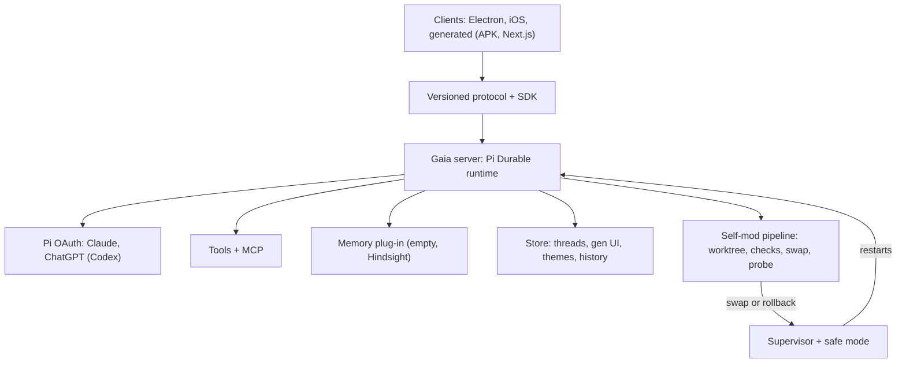

# Gaia: product spec and architecture

Status: locked v1.6, 8 Nov 2026. Decisions from Avi, 1 to 8 Nov 2026.

Changelog:
- v0.2 (4 Nov 2026): sign-in and model traffic through Pi's built-in OAuth; Electron gets full terminal and file access; generative UI is real code changes through the self-mod pipeline.
- v1.0 (4 Nov 2026): locked. Homelab hosting requirements added as v0.1 musts (see `docs/hosting.md`).
- v1.1 (4 Nov 2026): Avi removed the fixed 1 GB RAM requirement. RAM allocation can grow as homelab capacity is freed up.
- v1.2 (4 Nov 2026): Avi chose Board UI instead of assistant-ui. Use free MIT-licensed components with a plain default theme and editable theme tokens.
- v1.3 (5 Nov 2026): Avi authorised UI library and stack decisions for the overnight work. Base UI is preferred for new primitives. Radix is permitted where needed; assistant-ui, shadcn and existing React Aria or Board UI components may be used when they fit. Libraries must be free and openly licensed. Add genuine Pi effort controls and image attachments, and make onboarding progress after answers.
- v1.4 (5 Nov 2026): Avi authorised four isolated experience profiles as parallel acceptance cases: Dots-style central chat, Grokbot-style area Bots, Duet-style shared-memory channels and Hermes-style sessions. Add concurrent background work, subordinate agents, actual local Mac CLI and Agent Desktop tools, hosted web search through the existing Pi ChatGPT/Codex subscription, and task-specific plain-language activity using the supplied visual reference. Profile setup stays explicit and owner-confirmed. Existing owner data is preserved.
- v1.5 (5 Nov 2026): Founder reconciliation under Avi's delegated product authority. Chat shapes are called setups. Gaia proposes setups as cards in the conversation, with Use this setup and Not now. Not now hides a proposal and keeps its data. A confirmed setup can become the main chat through an explicit owner action, and the original chat stays listed and usable. The onboarding interview is offered after the first useful answer and is never offered again once skipped. New explicit facts in a sessions setup are shared across its sessions, and older facts keep their scope. Progress shows only the avatar until real activity exists. Retrying an attempt that started a machine action needs the owner's confirmation. The model menu never ranks models by parsing names. The independent-job runtime stays the conversation engine until measured gates justify a change. Protocol changes stay additive until callers migrate.
- v1.6 (8 Nov 2026): The owner approved a verification-only plan lease for isolated test copies while the owner's Gaia is stopped. It remains off unless started by hand.

## One-line pitch

Gaia is an open-source agent you run on your own machine. It starts as a single chat box and grows its own interface, tools, clients and agents around how you work. An Apache 2.0, self-hosted replacement for Hermes Agent that feels like Grok Bot. One owner per install.

## Principles

- Seed, not suite: ships with a chat box and nothing else. Everything else is grown on request.
- The chat is the app. Generated UI grows out of it, not around it.
- Headless brain: the server owns no UI. Every UI is a client of one public protocol.
- Self-change is normal and safe: staged, checked, health-probed, auto-rolled back.
- Local and owned: data, credentials and memory stay on the owner's machine.
- Plan sign-in, no API keys: Claude and ChatGPT plans through Pi's built-in OAuth; all model traffic routed through Pi.
  A verification-only plan lease lets an isolated test copy use the owner's plan while the owner's Gaia is stopped. It is off unless the owner starts it by hand.
- The owner holds the power: full machine access by default, and the responsibility that comes with it.
- Plain by default: a minimal, themeable interface using free, openly licensed components and editable theme tokens. Prefer Base UI for new primitives. Existing React Aria and Board UI components may remain; Radix, assistant-ui and shadcn are permitted when they fit. Choose for the actual interaction, footprint and accessibility.
- Open from day one: Apache 2.0, commercial use allowed.

## User journeys

### First run

1. Owner runs `docker compose up` (or the native start command). Gaia prints an address and a one-time pairing code.
2. The page shows a chat box and one assistant line asking the owner to connect ChatGPT or Claude.
3. After connection, Gaia answers requests straight away. After its first useful answer, it offers once to fit itself around how the owner works. The owner can start the short interview (who you are, one or many life areas, where you sit from chat to agentic) or choose Not now. A skipped interview is never offered again automatically. It stays available under About you.
4. When a different shape would help, Gaia proposes a setup as a card under its reply. The owner chooses Use this setup or Not now on the card. Typed agreement never confirms.

### Multi-area person

Says: work, uni, health, finances. Gaia creates four agents with their own memory scopes and a Grok Bot-style sidebar, plus a home agent that routes and summarises.

### Single-purpose person

Says: I just want a research assistant. Gaia stays one chat, adds a citations panel and search tools, and does not push agents or sidebars.

### Make yourself a Grok Bot clone

Gaia stages a UI change: sidebar of agents with live animated status and web glyph icons, per-agent threads, routines. Checks pass, it swaps, the client hot-reloads. Revert is one click in change history.

### Build me an Android client

Gaia scaffolds an app on the client SDK, runs the conformance suite against its own server, builds an APK in a sandboxed build container, and hands over the file plus pairing steps. Same path for a Next.js web client.

## Architecture

- Server: headless Node service on Pi Durable. Runs agents, durable workflows, compaction, tools and MCP.
- Providers: sign-in uses pi-ai's built-in Anthropic (Claude plan) and OpenAI Codex (ChatGPT plan) subscription logins. All model traffic goes through Pi, including native web search.
- Supervisor: a tiny, never self-modified process that starts the server, probes health and owns rollback.
- Generative UI: real code changes to the app itself. The AI may change any part of the UI, through the self-mod pipeline. The server serves the current UI modules; clients load them.
- Electron client: pairs once with a one-time code, like a Grok Bot computer, then gives the agent full terminal and file access on the Mac. No sandbox or command scoping in v0.1.
- Memory: empty by default behind a pluggable memory interface (for example Hindsight).

## Self-modification safety model

1. Propose: the agent writes a change set with a reason, in a fresh git worktree, never the live tree.
2. Check: typecheck, lint, unit tests, protocol conformance, and a boot test of the staged build in a sandbox.
3. Gate: if approval mode is on, the owner sees the diff and approves. Off by default; the owner can turn it on, or ask Gaia to.
4. Swap: supervisor snapshots the current release, then atomically points to the new build.
5. Probe: health endpoint, a scripted chat turn, and client reconnect within a time limit.
6. Rollback: any failed probe or crash loop restores the snapshot automatically and logs why.
7. Safe mode: after repeated failures, boot the last known-good core with self-mod disabled and a plain chat to diagnose.
8. History: every change is a commit with reason, checks and outcome; any one can be reverted.

> Protected core that self-mod cannot touch: the watchdog supervisor, rollback logic, safe mode and auth. Everything else, including every part of the UI, is fair game. The protected core is what makes free changes survivable.

## Protocol outline

| Area | Covers |
| --- | --- |
| Session | Pairing, device tokens, protocol version negotiation |
| Events | Streamed messages, tool-call hints, compaction notices, agent status |
| Tools | Calls, results, client-side tools (full terminal, files) offered by a client |
| Approvals | Permission prompts, self-mod approvals, decisions |
| Files | Upload, download, previews |
| Gen UI | Versioned UI code bundles and modules served by the server; clients load and hot-swap them, falling back to the last good bundle |
| Admin | Change history, revert, safe mode, diagnostics |

Ships with a TypeScript SDK and a client conformance suite. Breaking changes bump the major version.

## v0.1 requirements (musts)

Hosting (detail in `docs/hosting.md`):

- Runs natively as a Node service under systemd; ships a systemd unit or a single start command. Docker Compose also supported.
- Small footprint: target 2 vCPU, 512 MB swap, 16 GB disk. No fixed RAM limit; size RAM for the runtime, builds and checks.
- One configurable data dir (default `/var/lib/gaia`) holds all data and the self-modifying git repo, for easy backups.
- Configurable bind address and port; trusted reverse proxy support; plain HTTP behind the proxy.
- Default port must avoid 8096, 8264 and 8090.
- Outbound HTTPS only; no inbound requirement beyond the proxy.
- Health endpoint (for example `GET /healthz`) used by the supervisor and the proxy.

## v0.1 scope versus later

| v0.1 | Later |
| --- | --- |
| Docker Compose and native systemd seed | LXC template, Nix package |
| Chat box, model and effort controls, image attachments, tool and compaction hints | Rich trace and DeepSeek-style views (generated) |
| Claude and ChatGPT sign-in via Pi OAuth | More providers |
| Optional onboarding interview after the first answer, setups proposed in chat, multi-agent setup | Routines, cross-agent planning |
| Self-mod pipeline, safe mode, history | Approval mode polish |
| Protocol v1, SDK, conformance suite | Generated Android and Next.js clients |
| Electron client, full terminal and file access | iOS client; optional restricted mode |
| Memory interface, empty default | Hindsight adapter |

## Borrow from Aegis and Mars

- Mars (github.com/mars-s/mars): Pi Durable host (`packages/pi-host`), owner sign-in URL from setup, ChatGPT and Claude connection, staged host changes with health check and rollback watchdog, plugin cards and on-demand tool discovery. Gaia keeps its own minimal, themeable chat.
- Aegis (github.com/mars-s/Aegis): first-run greeting and local profile, patched UI that yields to newer built-ins after update, Tauri signed updater with backup and restore, DESIGN.md discipline.
- Leave behind: Aegis's canvas and Tauri shell, Mars's Next.js-coupled UI.

## Risks and open questions

- Naming: many projects use Gaia. GitHub repo is free; npm package and domain will likely need a suffix.
- Terminal access: unrestricted by design. A bad agent action can damage the Mac; the owner accepts that. Restricted mode comes later.
- Self-mod failures: tests that pass but break UX, migrations that cannot roll back, corrupted data. Needs data snapshots, not just code.
- Public address: needs TLS, pairing codes, device tokens, rate limits; default to LAN or tunnel only.
- Decided: gen UI is real app code changed through the self-mod pipeline, not declarative data.
- Open: how generated clients get signed and distributed.

## Milestone plan

1. M0: write protocol v1, supervisor design and repo skeleton (Apache 2.0).
2. M1: headless server with Pi Durable, plan sign-in, minimal web chat at the printed address, systemd unit and health endpoint.
3. M2: self-mod pipeline, safe mode and change history, tested with forced failures.
4. M3: onboarding interview and multi-agent setup.
5. M4: Electron client with pairing and full terminal and file access.
6. M5: UI code serving and hot-swap for gen UI; demo Grok Bot clone and solar system.
7. M6: public launch: docs, conformance suite, Compose image.
8. M7: iOS, LXC and Nix, generated Android and Next.js clients.

## Four-profile acceptance increment

This increment tests Gaia's ability to adapt to four working styles. The product references define interaction patterns, not provider changes or permission to reuse proprietary assets. All model traffic stays in Pi. Each isolated profile defaults to GPT-6.1 Sol with High effort for the test run. No profile may silently replace the owner's current chat.

| Experience | Navigation and context | Acceptance |
| --- | --- | --- |
| Central assistant | One minimal iMessage-like chat, with relevant context selected for each task. | A second request is accepted while the first continues. Genuine independent results return to the same conversation. |
| Area Bots | Home and named Bots in a sidebar, with researched openly licensed SVG avatars. Each Bot owns its role, memory and conversation. | Two Bots keep separate context and drafts. Home can coordinate actual subordinate work. |
| Shared channels | One assistant identity and shared memory, with topic channels and separate conversation histories. | A remembered fact is available across channels while private thread content is included only when explicitly selected. |
| Sessions | A left session list, New session, durable history and scoped controls. | New sessions retain older sessions. Model, effort and compaction target the selected session. Explicit facts remembered from v1.5 are available in every session of that setup. Earlier facts keep their session. Transcripts are never shared. |

Progress is a small avatar followed by quiet, task-specific language. The agent supplies wording describing the actual action, such as Verifying RE in Jellyfin. Real execution drives its start, updates and settlement. Until real activity exists, only the avatar shows, with a subtle pulse and no words. Streamed reply text appears in the reply itself. The job title, the owner's prompt, generic words such as Running or Thinking, timers, raw tool names, command arguments and fixed status phrases are never shown as progress. Work delegated between conversations is labelled with its source and never shown as the owner's words.

In the product these shapes are called setups. Profile refers only to the owner's About you details. A setup proposal appears as a card under the reply that proposed it. A newer proposal from the same conversation replaces older pending ones. Not now and replacement hide a proposal without deleting stored data. Use this setup confirms the exact revision shown, opens the setup and makes it the main chat, and the card states this before the click. The earlier chat stays listed as Original chat, unchanged and usable, and can be made main again at any time. Safe mode always opens the original chat. Owner messages are never copied or moved without a separate explicit confirmation.

The model menu lists every runnable model in the live catalogue, plus the current selection even when it is no longer offered. A long catalogue shows recently used models first and the rest under All models, in catalogue order. Gaia never ranks, groups or hides models by guessing from their names.

The independent-job runtime is the conversation engine for this increment. A new engine, a new store layout or a protocol major version needs recorded measurements that meet the gates in `docs/engine.md`, migrated callers, and the checked owner-upgrade path.

Background tasks have stable identities, bounded concurrency, scoped cancellation and truthful results. A disconnected client does not cancel them. Restarted work must remain visible and must not silently repeat an uncertain external effect. Chat, uploads and configuration must not be globally blocked by unrelated work.

Trying again after an attempt that started a machine action needs the owner's confirmation, even when that action finished. Read-only search and actions cancelled before they started can be retried freely. Gaia does not resume or deduplicate earlier attempts.

The local Mac capability follows the existing full-owner-access decision. Shell and Agent Desktop are actual tools with process lifetime control and safe environment handling. Candidate checks, probes and safe mode receive no machine tools. The protected self-change allowlist and auth remain protected. Same-user shell access is not a malicious-agent isolation boundary.

The acceptance loop uses isolated profile data, owned local form and webhook fixtures, deterministic runtime tests, real subscription requests and native UI checks. Missing capabilities are implemented and the failed scenario is rerun. Sourced bot assets include licence and provenance. One checked commit concerns one behaviour.
